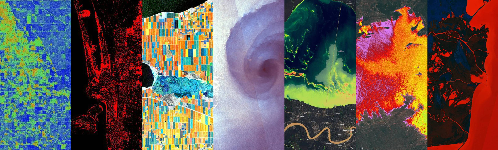

# Copernicus Data Space Ecosystem Sentinel Hub Custom Scripts Repository



This repository contains a collection of custom scripts for the [Copernicus Browser](https://browser.dataspace.copernicus.eu/) and the [Sentinel Hub APIs](https://dataspace.copernicus.eu/analyse/apis/sentinel-hub) on the [Copernicus Data Space Ecosystem](https://dataspace.copernicus.eu/).

Custom scripts (or evalscripts) are a piece of Javascript code, used to visualize satellite imagery and to control what values the Sentinel Hub services will return. Any visualization of any constellation (e.g. Sentinel-2 satellite), even a simple true color composite, is dictated by a custom script. You can find an introduction to evalscripts [here](https://documentation.dataspace.copernicus.eu/APIs/SentinelHub/Evalscript.html) and more details on how to write and structure your own evalscript [here](https://documentation.dataspace.copernicus.eu/APIs/SentinelHub/Evalscript/Functions.html).

If you would like to contribute and add a new custom script to this repository, please see [Section 1](#1-how-to-add-a-new-custom-script) and [Section 2](#2-working-with-taxonomies-and-metadata). Section 3 and onwards are only relevant for site development. The repository also hosts [openEO process graphs](https://documentation.dataspace.copernicus.eu/APIs/openEO/Processes.html), that can be used for visualisation in the Copernicus Browser. For details on how to contribute by adding a new process graph to this repository, see [How to Add an openEO Process Graph](#how-to-add-an-openeo-process-graph).

---

## 1. How to Add a New Custom Script

The technology used in this project to generate custom script pages is [Hugo](https://gohugo.io/). Custom scripts are managed as **Hugo Leaf Bundles** (directories containing an `index.md` and related local assets; for details see the [official documentation](https://gohugo.io/content-management/organization/)). This isolates script codes, preview images, and markup descriptions.

### Step-by-Step Instructions

#### Step 1: Fork and clone this repository
Before you can start creating your custom script contribution, make sure to [fork this repository](https://docs.github.com/en/pull-requests/how-tos/work-with-forks/fork-a-repo) to your GitHub account, and [clone it](https://docs.github.com/en/repositories/creating-and-managing-repositories/cloning-a-repository) to create a local copy on your computer.

#### Step 2: Create a Leaf Bundle Folder

Navigate to the directory of the respective satellite sensor (inside `content/script/<sensor>/`) and create a new directory for your script:

```bash
mkdir -p content/script/sentinel-2/my_new_script/fig
```

_Preferably use ["snake_case"](https://simple.wikipedia.org/wiki/Snake_case) (underscores instead of spaces) if more than one word is used._

#### Step 3: Add the Source Code File

Place the raw Sentinel Hub JavaScript file into your new directory:

- `content/script/sentinel-2/my_new_script/script.js`

_Note: You can include multiple JS files if your script has variations (e.g., `script_v1.js`, `script_v2.js`). You will reference these in the metadata._

#### Step 4: Add Preview Figures

Save representative screenshots (e.g., comparison images showing the visual outputs or specific highlights) inside your `fig/` folder:

- `content/script/sentinel-2/my_new_script/fig/example_output.png`

#### Step 5: Create the `index.md` and Configure Frontmatter

Create an `index.md` file inside `content/script/sentinel-2/my_new_script/` and configure the metadata at the top (frontmatter):

```markdown
---
title: "My Amazing Custom Script"
evalscripts: ["script.js"]
domains: ["vegetation", "agriculture"]
---

## General description of the script

Provide a clear and concise explanation of what your script does, what formula or index it relies on (e.g., NDVI, NDWI), and any thresholds used.

## Author of the script

[Author Name]

## Description of representative images

Explain what is depicted in the figures.

Example 1:

```

#### Step 6: Format and Lint Your Changes

Before opening a Pull Request, ensure your contribution passes formatting and linting checks. These checks are enforced in CI and your PR will fail if they don't pass.

##### Installing the required tools

The required linting and formatting tools in this project are ran with [Node.js](https://nodejs.org/). First, download and install Node.js by following the steps indicated [here](https://nodejs.org/en/download) for your OS.

Then, from your local repository clone, open a terminal and use `npm` (Node Package Manager) in the repo root to install the required Node.js tools:

```bash
npm install # One-time setup: installs Prettier, ESLint, markdownlint
```

##### Running the tools

Once the tools are successfully installed, you can run them as follows before committing:

```bash
npm run format # Markdown, JS, SCSS, YAML, JSON
npm run lint   # ESLint and markdownlint
```

#### Step 7: Create a Pull Request

Once your new bundle folder is ready and passes all checks, you can open a new Pull Request in https://github.com/eu-cdse/sentinel-hub-custom-scripts/pulls for review.

---

### How to Add an openEO Process Graph

If you wish to add an openEO process graph, the steps are very similar. Instead of adding a JavaScript file to the bundle folder, add your process graph as a JSON file. Then, you can reference it in the `index.md` frontmatter with the `process-graphs` key as:

```markdown
---
title: "My Amazing openEO process graph"
process-graphs: ["process\_graph.json"]
domains: ["vegetation", "agriculture"]
---
```

Note that only the following collections support openEO process graphs in the Copernicus Browser:

- S2L1C
- S2L2A
- S2 Annual Mosaic
- S2 Quarterly Mosaic
- S1 GRD Monthly Mosaic DH
- S1 GRD Monthly Mosaic IW

---

## 2. Working with Taxonomies and Metadata

Taxonomies are configured globally in `config/_default/hugo.toml`. They enable filtering, tags, and robust categorization across the site.

When you add a script, you can specify terms for any of these supported taxonomies in the frontmatter of your `index.md`:

| Taxonomy          | Frontmatter Key | Common Values / Terms                                                                                                                                        |
| :---------------- | :-------------- | :----------------------------------------------------------------------------------------------------------------------------------------------------------- |
| **Types**         | `types`         | `composite`, `index`, `regression`, `classification`                                                                                                         |
| **Verifications** | `verifications` | `cites literature`, `cites operational use case`                                                                                                             |
| **Default**       | `default`       | `default`, `custom`                                                                                                                                          |
| **Domains**       | `domains`       | `atmosphere`, `agriculture`, `disasters`, `urban`, `water`, `vegetation`, `forest`, `fire`, `flood`, `geomorphology`, `art`, `preprocessing`, `snow and ice` |
| **Data-Sources**  | `data-sources`  | `Data fusion`, `Sentinel-1`, `Sentinel-2`, `Sentinel-3`, `Sentinel-5P`, `CLMS`, `DEM`                                                                        |
| **Resolutions**   | `resolutions`   | `10m`, `60m`, `300m` ...                                                                                                                                     |

Sentinel 2 Band resolutions:

| Band                         | Resolution |
| :--------------------------- | :--------- |
| Band 1 – Coastal aerosol     | 60         |
| Band 2 – Blue                | 10         |
| Band 3 – Green               | 10         |
| Band 4 – Red                 | 10         |
| Band 5 – Vegetation red edge | 20         |
| Band 6 – Vegetation red edge | 20         |
| Band 7 – Vegetation red edge | 20         |
| Band 8 – NIR                 | 10         |
| Band 8A – Narrow NIR         | 20         |
| Band 9 – Water vapour        | 60         |
| Band 10 – SWIR – Cirrus      | 60         |
| Band 11 – SWIR               | 20         |
| Band 12 – SWIR               | 20         |

Explanation of types:

- **composite**: bands shown as red/green/blue so the output is an image, generated by assigning a spectral product to each band of an image (like RGB ratio, like true color)
- **index**: a fixed formula that scores every pixel on one property, a scalar generated by calculating a single value from one or more spectral bands and visualizing it with a palette (like NDVI)
- **regression**: a real physical quantity you could measure with an instrument, an index that is calibrated to a meaningful physical quantity that has a dimension (like Leaf Area Index, like land surface temperature)
- **classification**: every pixel sorted into one of a few named categories, an operation on one or more bands where the outcome is a unique value from a pre-defined set - typically based on threshold values from one or more regresssions (like flood mapping, like land cover)

### Frontmatter Example with Full Taxonomies:

```yaml
---
title: "Advanced Agricultural Monitoring"
evalscripts: ["script.js"]
process-graphs: ["process_graph.json"]
domains: ["agriculture", "vegetation"]
types: ["index"]
verifications: ["cites literature"]
resolutions: ["10m"]
data-sources: ["Sentinel-2"]
---
```

---

### Adding an Example Link

Add an `examples` entry to the frontmatter to show an **Evaluate and visualize** section with an **Open in Copernicus Browser** button. The button opens the browser at that location and date with your script loaded.

```yaml
examples:
    - zoom: 10
      lat: 46.0569
      lng: 14.5058
      datasetId: S2_L2A_CDAS
      fromTime: "2024-07-01T00:00:00.000Z"
      toTime: "2024-07-01T23:59:59.999Z"
      additionalQueryParams:
          - [maxcc, "20"]
```

| Field                   | Required | Description                                                                                                                                                                                                                                                                            |
| :---------------------- | :------- | :------------------------------------------------------------------------------------------------------------------------------------------------------------------------------------------------------------------------------------------------------------------------------------- |
| `zoom`, `lat`, `lng`    | yes      | Starting map position: `lat` and `lng` are the latitude and longitude of the map centre, `zoom` is the zoom level.                                                                                                                                                                     |
| `datasetId`             | yes      | Copernicus Browser dataset ID, e.g. `S2_L2A_CDAS`, `S2_L1C_CDAS`, `S1_CDAS_IW_VVVH`, `S3OLCI_CDAS`, `S5_NO2_CDAS`. See the [full list](https://github.com/eu-cdse/copernicus-browser/blob/main/public/datasets.txt). It is case-sensitive; an unknown ID falls back to Sentinel-2 L2A. |
| `fromTime`, `toTime`    | yes      | ISO-8601 date or date-time. If the dates differ, the link opens a time range.                                                                                                                                                                                                          |
| `evalscript`            | no       | Base64-encoded script. Leave it out to link the page's own `script.js` (recommended).                                                                                                                                                                                                  |
| `additionalQueryParams` | no       | Extra Copernicus Browser URL parameters as `[name, value]` pairs, e.g. cloud coverage (`maxcc`).                                                                                                                                                                                       |

The easiest way to get the values is to set up the view in [Copernicus Browser](https://browser.dataspace.copernicus.eu/) and copy them from the URL.

---

## 3. Local Development Setup

### Technology Stack

- **SSG:** Hugo (extended version recommended for Sass processing).
- **Styling:** SCSS (preprocessed using Hugo Pipes).
- **Interactivity:** Vanilla JavaScript for search, sidebars, and tab selectors.

### Formatting and Linting

| Files          | Formatter | Linter       |
| -------------- | --------- | ------------ |
| Markdown       | Prettier  | markdownlint |
| JavaScript     | Prettier  | ESLint       |
| Hugo templates | djlint    | djlint       |

Prettier also covers SCSS, YAML and JSON.

##### Installing additional tools for site development

Everything except djlint is installed with npm, so if you haven't installed Node.js and npm yet, check [Installing the required tools
](#installing-the-required-tools).

djlint is a Python tool. It is run through [uv](https://docs.astral.sh/uv/), which downloads it on first use, so there is nothing else to install:

```bash
brew install uv                                   # macOS
curl -LsSf https://astral.sh/uv/install.sh | sh   # Linux
choco install uv -confirm                         # Windows
```

##### Running the additional tools

```bash
npm run format                   # Markdown, JS, SCSS, YAML, JSON
npm run format:check             # report only, does not write

npm run format:templates         # Hugo templates
npm run format:templates:check   # report only, does not write

npm run lint                     # ESLint and markdownlint
npm run lint:templates           # djlint
```

`npm run lint` needs Node only, so you can check a content change without installing the Python tooling. The two `:templates` commands need uv.

---

### Running the project locally

To run this project locally, you need to [install](https://gohugo.io/installation/) the latest version of Hugo, then see the [documentation](https://gohugo.io/about/introduction/) about how hugo works.

_**Warning:**_ If you are using Ubuntu or Debian, apt version of Hugo is considerably older. Install with snap.

#### Prerequisites

##### Linux (Debian/Ubuntu)

We recommend installing the **extended** version of Hugo for Sass/SCSS compiling:

```bash
sudo apt install hugo
```

##### macOS (Homebrew)

```bash
brew install hugo
```

##### Windows (Chocolatey)

```bash
choco install hugo-extended -confirm
```

#### Running the Site

1. Clone this repository and open the project directory.
2. Spin up the development server:
    ```bash
    hugo server
    ```
3. Open your browser and go to `http://localhost:1313`.

The local server supports hot-reloading: changes to your Markdown content, JS, or SCSS files will instantly refresh the page in the browser.

---

## 4. Project Structure

Here is how the repository is organized:

```text
/sentinel-hub-custom-scripts/
├── config/                  # Environment-based site configurations
│   ├── _default/            # Global/default configuration
│   │   └── hugo.toml        # Defines site title, taxonomies, syntax highlighting
│   ├── development/
│   └── production/
├── content/                 # Site pages & script documentation
│   ├── _index.md            # Home page configuration and introduction
│   └── script/              # Script directories grouped by sensor
│       └── sentinel-5/
├── layouts/                 # HTML Templates & Partials
│   ├── baseof.html          # Shell layout (HTML wrapper, grid, head, footer)
│   ├── home.html            # Main landing page template
│   ├── _partials/           # Shared components (headers, footers, icons)
│   └── script/              # Templates specifically for the script pages
│       ├── list.html        # Sensor/listing page template
│       └── single.html      # Individual script page template (with interactive tabs)
├── assets/                  # Assets compiled & processed by Hugo Pipes
│   ├── js/
│   │   └── main.js          # Client-side logic (tab selection, copying, sidebar)
│   └── scss/
│       └── main.scss        # Site styling
└── static/                  # Static assets copied directly to build output
```

---

## 5. How Templates Render Scripts and Process Graphs Automatically

The templates in `layouts/script/single.html` contain robust logic designed to automate rendering.

When Hugo builds a script page it will:

1.  Read the `evalscripts` list in your frontmatter.
2.  Read the `process-graphs` list in your frontmatter.
3.  Grab the `.js` and `.json` files from the same folder.
4.  Generate selection tabs for them automatically.
5.  Apply server-side syntax highlighting (`transform.Highlight`) - JavaScript for `.js` files, JSON for `.json` files.
6.  Generate copy buttons to copy both the code block and the permalink of the raw file directly.
7.  Build the **Open in Copernicus Browser** button from `examples`, if the frontmatter has any (see [Adding an Example Link](#adding-an-example-link)).

This means you never need to copy-paste your code blocks into the markdown file manually! Simply keep the `.js` and `.json` files in your bundle folder.
